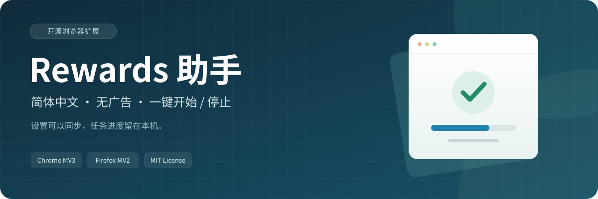
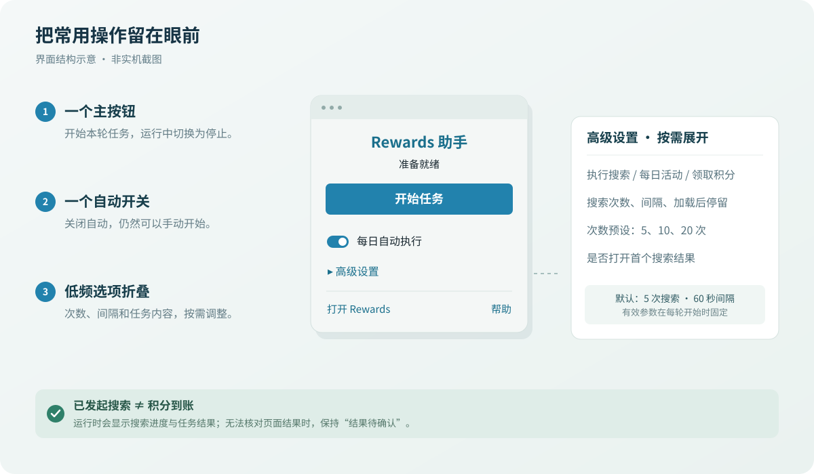

# Rewards 助手



<p align="center">
  <a href="LICENSE"></a>
  
  
  
</p>

简体中文、无广告的 Microsoft Rewards 浏览器扩展。按已保存的设置发起 Bing 搜索，并处理每日活动和积分领取流程。

基于 [spin311/MicrosoftRewardsWebsite](https://github.com/spin311/MicrosoftRewardsWebsite) 开发，使用 MIT 许可，保留原作者版权声明。

[项目主页](https://github.com/shixiaogaoya/MicrosoftRewardsWebsite) · [版本发布](https://github.com/shixiaogaoya/MicrosoftRewardsWebsite/releases) · [反馈问题](https://github.com/shixiaogaoya/MicrosoftRewardsWebsite/issues)

[界面展示](#界面展示) · [安装](#安装) · [快速开始](#快速开始) · [设置](#设置) · [常见问题](#常见问题) · [开发与打包](#开发与打包)

## 功能

- **中文界面**：按钮、设置、进度与结果默认使用简体中文。
- **简单操作**：一个开始／停止按钮，低频选项放入折叠的高级设置。
- **无广告推广**：移除产品推荐、App 二维码、捐赠入口和安装后的推广跳转。
- **按需执行**：选择搜索、每日活动和领取积分，支持单项手动重试。
- **每日自动**：浏览器启动和定时检查时，按本机当天的尝试记录决定是否执行。
- **本机进度**：任务记录保存在本机，用户设置使用浏览器同步存储。

> 搜索发起次数和「已完成流程」都不代表积分到账。无法确认页面结果时，扩展显示「结果待确认」。

## 界面展示



上图依据当前组件布局绘制，用于说明操作层级，是**结构示意图，非实机截图**。运行时会显示搜索进度与各项任务结果；实际效果仍需在加载扩展后确认。

| 高频操作 | 低频设置 | 结果反馈 |
| --- | --- | --- |
| 一键开始／停止本轮任务 | 默认折叠，按需展开 | 分别显示搜索、每日活动与领取结果 |
| 一个「每日自动执行」总开关 | 次数、间隔、加载后停留和任务选择 | 失败、待确认和已取消可单项重试 |

## 安装

首选从 Chrome 网上应用店安装：[Rewards 助手](https://chromewebstore.google.com/detail/fegakcnfificahomohhlahbehhkgnfhn)。商店页面上的版本是已发布版本；本仓库的源码改动在发布前不会出现在商店里。

也可以从 [Releases](https://github.com/shixiaogaoya/MicrosoftRewardsWebsite/releases) 下载 ZIP，或按下面的方法从源码构建后手动加载。Firefox 没有对应的商店页面，仍使用含 `firefox` 的 ZIP 或源码构建。预发布版仍需浏览器实测，使用前请查看发布说明和[已知问题](#已知问题与验证范围)。

### 开发者手动加载

准备 Node.js 22 和 npm；Node.js 版本与仓库 CI 配置一致。

```bash
git clone https://github.com/shixiaogaoya/MicrosoftRewardsWebsite.git
cd MicrosoftRewardsWebsite/wxt
npm ci
```

按浏览器选择构建目标，以下命令在 `wxt/` 执行：

| 浏览器 | 构建命令 | 产物目录（相对仓库根目录） |
| --- | --- | --- |
| Chrome | `npm run build` | `wxt/dist/chrome-mv3/` |
| Firefox | `npm run build:firefox` | `wxt/dist/firefox-mv2/` |

**Chrome**：打开 `chrome://extensions`，开启「开发者模式」，点击「加载已解压的扩展程序」，选择 `wxt/dist/chrome-mv3/`，然后将扩展固定到工具栏。

**Firefox（临时加载，用于测试）**：打开 `about:debugging#/runtime/this-firefox`，点击「临时载入附加组件」，选择 `wxt/dist/firefox-mv2/manifest.json`。

## 快速开始

1. 点击弹窗底部「打开 Rewards」，确认目标账号已登录。
2. 点击首页「高级设置」选择任务。默认启用搜索和每日活动；领取积分、打开首个搜索结果默认关闭。
3. 点击「开始任务」，查看搜索进度和各项结果。
4. 需要中止时点击「停止任务」；显示「正在停止」时等待本轮收尾。
5. 需要每天自动执行时开启「每日自动执行」。关闭自动后，仍可手动开始。

每日活动页面运行时可能短暂切到前台；结束后扩展会尝试恢复先前的活动标签页。

## 设置

设置入口在首页底部「高级设置」。搜索参数卡片里，次数预设是 5 次、10 次、20 次三个快捷按钮，只改搜索次数。次数与三个按钮都不一致时显示「自定义」。搜索次数输入框始终可编辑，`searches` 是次数的唯一来源；旧的账号等级字段即使还留在存储里，也不会再决定次数。「打开首个结果」是搜索的附属设置，不与每日活动、领取积分并列。

| 参数 | 范围 | 默认值 | 含义 |
| --- | --- | --- | --- |
| 搜索次数 | 1～999 的整数 | 5 | 本轮计划发起的搜索数 |
| 搜索间隔 | 0～9999 的整数秒 | 60 | 目标间隔，实际带少量随机波动 |
| 加载后停留 | 0～300 的整数秒 | 5 | 页面加载完成后，等待指定时间再关闭 |

- 间隔填 **0**：最小间隔约 1 秒，不会同时打开全部标签页；后台挂起后短间隔可能延后。
- 加载后停留填 **0**：页面加载完成后尽快关闭，仍可能有短暂延迟。
- 空值、小数、负数和越界值不会作为有效设置保存；输入框失焦后恢复先前有效值。
- 搜索次数、间隔和加载后停留在一轮开始时固定，之后修改应用于下一轮。运行中修改时，首页提示「设置将用于下一轮任务」。
- 关闭「每日自动执行」只影响后续自动触发，不会中止当前任务；中止请使用「停止任务」。

设置随浏览器账号同步；本机进度、结果和每日尝试日期不参与同步。

## 任务结果

| 显示 | 含义 |
| --- | --- |
| 已发起 X/Y 次搜索 | 已打开的搜索标签页数，不是已计分搜索数 |
| 进行中 | 对应任务尚在执行 |
| 已完成流程 | 搜索步骤已发起完毕，或领取控件出现实现所识别的完成状态；不是到账回执 |
| 无需执行 | 页面明确显示该项没有待执行内容 |
| 结果待确认 | 页面标记不足、等待超时或后台中断，无法确认最终结果 |
| 失败 | 操作遇到错误，原因显示在该任务下方 |
| 已取消 | 本轮进行中的任务被停止；不计入「需处理」数量 |

每日活动点击卡片后，当前仍统一显示「结果待确认」：页面没有可靠的完成标记。找不到卡片、页面未加载和登录失效会分别说明原因；没有证据时保持待确认。点击成功、标签页关闭或等待结束，都不能直接当作任务完成。关闭领取弹层本身不会被当作领取成功。

失败、取消或待确认项可以单独重试。重试只针对对应项，并尊重任务开关。失败和待确认汇总为「N 项需处理」；已取消单独保留，不计入这个数量。顶部在全部正常结束时显示「本轮已完成」，手动停止后显示「本轮已停止」。最终积分以 Rewards 页面为准。

## 自动执行与停止

- **自动开始**：总开关开启且至少选择一项任务时，浏览器启动会检查，之后约每 6 小时检查一次；不是固定时刻执行。弹窗能读到现有 alarm 时，显示「下次检查」的日期和时间，这不是「下次执行」。
- **当日去重**：以本机日历日为界。某项任务当天已尝试过，自动检查便不再重复，无论此前结果如何；弹窗按任务显示「今日已尝试」，已尝试不等于已完成。手动开始和单项重试可以再次执行。
- **停止本轮**：阻止后续步骤，并按清理策略处理扩展创建的页面；不更改自动或任务开关。已经发出的请求和已发生的点击无法撤销。
- **后台唤醒**：通过浏览器 alarm 和本机记录恢复调度或收束未确认状态。
- **浏览器重启**：结束未完成的旧轮次；仍未结束的任务按未确认处理。当天尚未尝试且自动开启时，启动检查可以开始新一轮。

## 常见问题

<details>
<summary>关闭自动后还能手动执行吗？</summary>

可以，任务内容由高级设置决定。

</details>

<details>
<summary>为什么不能开始？</summary>

检查是否仍在读取状态、正在停止上一轮，或没有选择任何任务。

</details>

<details>
<summary>为什么搜索完成后积分没增加？</summary>

扩展统计的是搜索发起次数，无法保证每次操作被服务端计分。请到 Rewards 页面核对账号和最终结果。

</details>

<details>
<summary>为什么每日活动显示待确认？</summary>

当前实现不能为所有卡片识别可靠的完成信号；该状态不表示已经成功，也不表示一定失败。

</details>

## 已知问题与验证范围

- 设置写入以浏览器存储的真实结果为准：成功后显示「已保存」，失败时显示「保存失败，请重试」。同一次打开弹窗内，把设置改动后再改回刚打开时的值，也会写入。尚未在真实浏览器里核对弹窗保存提示。
- 尚未完成真实浏览器中的弹窗、停止、后台休眠与唤醒验收。
- 尚未用真实 Rewards 账号验证页面兼容性及积分到账。单元测试与构建通过不代表这些环节已经通过。

## 开发与打包

扩展源码在 `wxt/`，使用 WXT、React、TypeScript 和 Vitest，一套源码构建 Chrome MV3 与 Firefox MV2。以下命令均在 `wxt/` 执行：

| 目的 | 命令 |
| --- | --- |
| Chrome 开发模式 | `npm run dev` |
| Firefox 开发模式 | `npm run dev:firefox` |
| 类型检查 | `npm run compile` |
| 单元测试 | `npm test` |
| Chrome 生产构建 | `npm run build` |
| Firefox 生产构建 | `npm run build:firefox` |
| Chrome ZIP 打包 | `npm run zip` |
| Firefox ZIP 打包 | `npm run zip:firefox` |

构建输出位于 `wxt/dist/`，不加入 Git 跟踪。发布时应从确定的提交生成标签和对应产物，在发布说明中区分模拟验证与浏览器实测。创建 GitHub Release 不等于已发布到浏览器商店。

GitHub Actions 支持在线构建和 GitHub Release。工作流名为「在线构建扩展（可能创建 Release）」：更新 `master`、手动运行，或推送以 `v` 开头的标签时，都会对**本次提交**做类型检查、单元测试和 Chrome／Firefox 打包。任一环节失败则不会发布。ZIP 可在运行记录的 Artifacts 下载。

正式版本取本次提交里 `wxt/package.json` 的 `version`，对应标签为 `v${version}`。`master` 推送或手动运行时，只有该 Release **尚不存在**才会创建指向本次提交的附注标签并上传两份 ZIP；同一版本之后的普通提交仍运行检查和打包，但跳过发布，不移动已有标签，也不覆盖已有 Release。手动运行必须勾选确认项，因为确认后可能创建 Release，并在 `master` 上自动提交 Chrome 商店审核。

推送已有的 `v*` 标签时仍会发布，但正式标签必须与包内版本一致，且标签必须指向本次构建的提交；名称含 `-` 的标签（如 `v3.1.3-beta.1`）沿用预发布处理，并使用该标签自己的附注作为发布说明。已有 Release 时直接跳过。自动创建的标签附注会写明版本、提交和两个 ZIP 的用途，供 `--notes-from-tag` 使用；重跑时会先拉取已有标签，以便读取附注。GitHub Release 使用 GitHub 自带的 `GITHUB_TOKEN` 创建。创建 Release 或完成本地构建，都不等于已经发布到商店。

### 发布到 Chrome 网上应用店

`master` 构建成功并**新建正式 Release** 后，构建工作流会调用「发布到 Chrome 网上应用店」（`.github/workflows/publish-cws.yml`），自动上传该 Release 的 Chrome ZIP 并提交审核。ZIP 直接取自 Release，不重新构建。同版本已有 Release、标签推送、预发布或任何前置失败都不会自动提审；审核通过后仍需手动上线。

自动入口通过同一构建流程中的可复用工作流调用，不依赖 Release 事件触发。商店工作流也保留手动入口，可用于读取状态或重新提交指定 Release。自动与手动入口共用校验、状态保护和并发锁。

认证使用 Workload Identity Federation（WIF）换取短期访问令牌，不使用 JSON 密钥文件、refresh token 或长期凭据。仓库需要在 **Settings → Secrets and variables → Actions → Variables** 里配置四个 Repository Variable：

| Variable | 内容 |
| --- | --- |
| `CWS_WIF_PROVIDER` | 完整 WIF 提供方资源名，形如 `projects/<编号>/locations/global/workloadIdentityPools/<池>/providers/<提供方>` |
| `CWS_SERVICE_ACCOUNT` | 已在 Chrome 网上应用店开发者后台 **Account／账号 → Service account email／服务账号邮箱** 关联的服务账号邮箱 |
| `CWS_EXTENSION_ID` | 商店条目 ID（32 位小写字母 a–p） |
| `CWS_PUBLISHER_ID` | 商店发布者 ID |

`CWS_WIF_PROVIDER` 按原样保存，脚本只有格式校验，不做任何“修正”。当前提供方 ID 以 `providers/-github` 结尾，开头的横线是真实值的一部分，删掉或改写会导致认证失败。

Google 侧目前只允许 `shixiaogaoya/MicrosoftRewardsWebsite` 仓库的 `master` 分支通过 WIF 认证，因此自动调用和手动运行都必须来自 `master`。可复用工作流继承调用方事件，脚本只接受 `push` 或 `workflow_dispatch`，并用 `GITHUB_REF` 校验分支；不满足时直接失败。商店任务所需的 GitHub 权限只有 `contents: read` 和 `id-token: write`。

手动运行时选择 `master`，再选择以下模式（自动入口固定使用 `submit`）：

| 模式 | `release_tag` | 行为 |
| --- | --- | --- |
| `check`（默认） | 忽略 | 校验配置、获取令牌、调用 V2 `fetchStatus`，在运行摘要里显示扩展 ID、已发布版本和当前审核状态。**不上传、不提审、不改变商店状态**，也不要求对应 Release 存在。 |
| `submit` | 必填（如 `v3.1.3`） | 从指定 Release 下载 Chrome ZIP → 校验 Release、ZIP 与根目录 `manifest.json` 版本 → 查询状态 → 上传 → 确认上传成功 → 提交审核。 |

`submit` 的保护措施：

- `release_tag` 必须是正式版本标签，不接受预发布标签；Release 必须存在、非草稿、非预发布。
- ZIP 必须恰好一个 `*-chrome.zip`，根目录有可解析的 `manifest.json`，`manifest_version` 为 3，且版本与标签一致（标签 `v3.1.3` 对应版本 `3.1.3`）。
- 商店有版本在审核、已有其他版本处于 STAGED、已发布同一版本、条目被下架，或仍有上传在处理中时，直接失败，不覆盖、不重复提交。只有同版本已处于 STAGED 时跳过上传，直接提审。
- 上传返回 `IN_PROGRESS` 时只在限定次数与间隔内轮询 `fetchStatus`，确认 `SUCCEEDED` 后才提审；超时或失败一律不提审。
- 提审请求体固定为 `{"publishType":"STAGED_PUBLISH","skipReview":false,"blockOnWarnings":true}`。

商店相关运行通过 concurrency 串行执行，且 `cancel-in-progress: false`：已经发出的上传或提审不会被新运行取消。`submit` 成功后 CI 即结束，**不等待人工审核**；审核通过后还需要在开发者后台手动点击上线。读取状态和提交审核是两件不同的事，运行成功只代表请求已被商店接受，不代表扩展已经上线。

若商店任务失败，已经创建的 GitHub Release 会保留。修复阻塞后可以重跑失败的商店作业，或手动使用 `submit` 和原来的 `release_tag`；无需为重试提升版本。已有版本正在审核时会阻止重复提交。

本地验证覆盖脚本逻辑：`.github/scripts/publish-release.test.sh` 和 `.github/scripts/publish-cws.test.sh` 使用桩，不访问网络或真实商店。2026-11-04 已在 GitHub Actions 验证 WIF 认证、读取状态、上传和提审：[`v3.1.4` 提交记录](https://github.com/shixiaogaoya/MicrosoftRewardsWebsite/actions/runs/41818144486) 返回 `PENDING_REVIEW`。这次记录使用手动入口；新增的自动调用仍需在后续新正式版本发布时验证。

## 反馈与许可

请在 [Issues](https://github.com/shixiaogaoya/MicrosoftRewardsWebsite/issues) 提供浏览器与扩展版本、任务设置、复现步骤和结果截图。截图请遮住账号、邮箱等个人信息，不提交登录凭据。

本项目基于 [spin311/MicrosoftRewardsWebsite](https://github.com/spin311/MicrosoftRewardsWebsite)，保留原作者版权及 [MIT License](LICENSE)。

Copyright (c) 2024 spin311.
