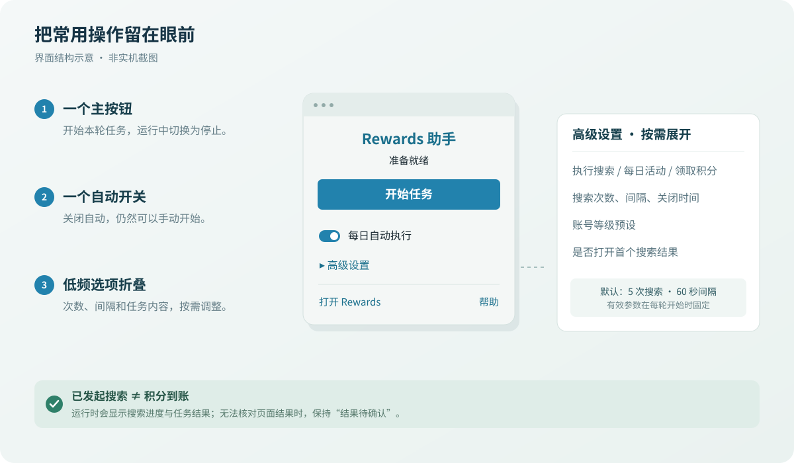

# Rewards 助手


<p align="center">
  <a href="LICENSE"></a>
  
  
  
</p>

简体中文、无广告的 Microsoft Rewards 浏览器扩展。按已保存的设置发起 Bing 搜索，并处理每日活动和积分领取流程。

基于 [spin311/MicrosoftRewardsWebsite](https://github.com/spin311/MicrosoftRewardsWebsite) 开发，使用 MIT 许可，保留原作者版权声明。

[项目主页](https://github.com/shixiaogaoya/MicrosoftRewardsWebsite) · [版本发布](https://github.com/shixiaogaoya/MicrosoftRewardsWebsite/releases) · [反馈问题](https://github.com/shixiaogaoya/MicrosoftRewardsWebsite/issues)

[界面展示](#界面展示) · [安装](#安装) · [快速开始](#快速开始) · [设置](#设置) · [常见问题](#常见问题) · [开发与打包](#开发与打包)

## 功能

- **中文界面**：按钮、设置、进度与结果默认使用简体中文。
- **简单操作**：一个开始／停止按钮，低频选项放入折叠的高级设置。
- **无广告推广**：移除产品推荐、App 二维码、捐赠入口和安装后的推广跳转。
- **按需执行**：选择搜索、每日活动和领取积分，支持单项手动重试。
- **每日自动**：浏览器启动和定时检查时，按本机当天的尝试记录决定是否执行。
- **本机进度**：任务记录保存在本机，用户设置使用浏览器同步存储。

> 搜索发起次数和「已完成流程」都不代表积分到账。无法确认页面结果时，扩展显示「结果待确认」。

## 界面展示



上图依据当前组件布局绘制，用于说明操作层级，是**结构示意图，非实机截图**。运行时会显示搜索进度与各项任务结果；实际效果仍需在加载扩展后确认。

| 高频操作 | 低频设置 | 结果反馈 |
| --- | --- | --- |
| 一键开始／停止本轮任务 | 默认折叠，按需展开 | 分别显示搜索、每日活动与领取结果 |
| 一个「每日自动执行」总开关 | 次数、间隔、关闭时间和任务选择 | 未确认结果保留详情与单项重试 |

## 安装

从 [Releases](https://github.com/shixiaogaoya/MicrosoftRewardsWebsite/releases) 下载本 fork 的扩展 ZIP：Chrome / Edge 选择文件名含 `chrome` 的版本，Firefox 选择含 `firefox` 的版本。解压后按下方步骤加载扩展。预发布版仍需浏览器实测，使用前请查看发布说明和[已知问题](#已知问题与验证范围)。

上游商店版本不包含本 fork 的全部改动，也可以按下面的方法从源码构建。

### 从源码构建

准备 Node.js 22 和 npm；Node.js 版本与仓库 CI 配置一致。

```bash
git clone https://github.com/shixiaogaoya/MicrosoftRewardsWebsite.git
cd MicrosoftRewardsWebsite/wxt
npm ci
```

按浏览器选择构建目标，以下命令在 `wxt/` 执行：

| 浏览器 | 构建命令 | 产物目录（相对仓库根目录） |
| --- | --- | --- |
| Chrome | `npm run build` | `wxt/dist/chrome-mv3/` |
| Firefox | `npm run build:firefox` | `wxt/dist/firefox-mv2/` |

**Chrome**：打开 `chrome://extensions`，开启「开发者模式」，点击「加载已解压的扩展程序」，选择 `wxt/dist/chrome-mv3/`，然后将扩展固定到工具栏。

**Firefox（临时加载，用于测试）**：打开 `about:debugging#/runtime/this-firefox`，点击「临时载入附加组件」，选择 `wxt/dist/firefox-mv2/manifest.json`。

## 快速开始

1. 点击弹窗底部「打开 Rewards」，确认目标账号已登录。
2. 按需展开「高级设置」选择任务。默认启用搜索和每日活动；领取积分、打开首个搜索结果默认关闭。
3. 点击「开始任务」，查看搜索进度和各项结果。
4. 需要中止时点击「停止任务」；显示「正在停止」时等待本轮收尾。
5. 需要每天自动执行时开启「每日自动执行」。关闭自动后，仍可手动开始。

每日活动页面运行时可能短暂切到前台；结束后扩展会尝试恢复先前的活动标签页。

## 设置

高级设置包含任务选择、搜索参数、账号等级预设和「打开首个搜索结果」。等级预设仅在主动切换时调整次数：会员 5、银级 10、金级 20；它是次数快捷设置，不会检测或更改真实账号等级。

| 参数 | 范围 | 默认值 | 含义 |
| --- | --- | --- | --- |
| 搜索次数 | 1～999 的整数 | 5 | 本轮计划发起的搜索数 |
| 搜索间隔 | 0～9999 的整数秒 | 60 | 目标间隔，实际带少量随机波动 |
| 标签页关闭时间 | 0～300 的整数秒 | 5 | 搜索页加载完成后的停留时间 |

- 间隔填 **0**：最小间隔约 1 秒，不会同时打开全部标签页；后台挂起后短间隔可能延后。
- 关闭时间填 **0**：加载完成后尽快关闭，仍可能有短暂延迟。
- 空值、小数、负数和越界值不会作为有效设置保存；输入框失焦后恢复先前有效值。
- 搜索次数、间隔和关闭时间在一轮开始时固定，之后修改应用于下一轮。
- 关闭「每日自动执行」只影响后续自动触发，不会中止当前任务；中止请使用「停止任务」。

设置随浏览器账号同步；本机进度、结果和每日尝试日期不参与同步。

## 任务结果

| 显示 | 含义 |
| --- | --- |
| 已发起 X/Y 次搜索 | 已打开的搜索标签页数，不是已计分搜索数 |
| 进行中 | 对应任务尚在执行 |
| 已完成流程 | 搜索步骤已发起完毕，或领取控件出现实现所识别的完成状态；不是到账回执 |
| 无需执行 | 页面明确显示该项没有待执行内容 |
| 结果待确认 | 页面标记不足、等待超时或后台中断，无法确认最终结果 |
| 失败 | 操作遇到错误，展开详情查看原因 |
| 已取消 | 本轮进行中的任务被停止 |

每日活动卡片即使已经点击，只要无法读取可靠的完成标记，也会显示「结果待确认」。关闭领取弹层本身不会被当作领取成功。

失败、取消或待确认项可在「查看详情」中点击「重试此任务」。重试只针对对应项，并尊重任务开关。最终积分以 Rewards 页面为准。

## 自动执行与停止

- **自动开始**：总开关开启且至少选择一项任务时，浏览器启动会检查，之后约每 6 小时检查一次；不是固定午夜执行。
- **当日去重**：以本机日历日为界。某项任务当天已尝试过，自动检查便不再重复，无论此前结果如何；手动开始和单项重试可以再次执行。
- **停止本轮**：阻止后续步骤，并按清理策略处理扩展创建的页面；不更改自动或任务开关。已经发出的请求和已发生的点击无法撤销。
- **后台唤醒**：通过浏览器 alarm 和本机记录恢复调度或收束未确认状态。
- **浏览器重启**：结束未完成的旧轮次；仍未结束的任务按未确认处理。当天尚未尝试且自动开启时，启动检查可以开始新一轮。

## 常见问题

<details>
<summary>关闭自动后还能手动执行吗？</summary>

可以，任务内容由高级设置决定。

</details>

<details>
<summary>为什么不能开始？</summary>

检查是否仍在读取状态、正在停止上一轮，或没有选择任何任务。

</details>

<details>
<summary>为什么搜索完成后积分没增加？</summary>

扩展统计的是搜索发起次数，无法保证每次操作被服务端计分。请到 Rewards 页面核对账号和最终结果。

</details>

<details>
<summary>为什么每日活动显示待确认？</summary>

当前实现不能为所有卡片识别可靠的完成信号；该状态不表示已经成功，也不表示一定失败。

</details>

## 已知问题与验证范围

- 设置保存仍有已知问题：同一次打开弹窗内，将设置改动后再改回刚打开时的值，最后一次更改可能没有持久化。调整后请关闭并重新打开弹窗核对；正式发布前应修复此问题。
- 尚未完成真实浏览器中的弹窗、停止、后台休眠与唤醒验收。
- 尚未用真实 Rewards 账号验证页面兼容性及积分到账。单元测试与构建通过不代表这些环节已经通过。

## 开发与打包

扩展源码在 `wxt/`，使用 WXT、React、TypeScript 和 Vitest，一套源码构建 Chrome MV3 与 Firefox MV2。以下命令均在 `wxt/` 执行：

| 目的 | 命令 |
| --- | --- |
| Chrome 开发模式 | `npm run dev` |
| Firefox 开发模式 | `npm run dev:firefox` |
| 类型检查 | `npm run compile` |
| 单元测试 | `npm test` |
| Chrome 生产构建 | `npm run build` |
| Firefox 生产构建 | `npm run build:firefox` |
| Chrome ZIP 打包 | `npm run zip` |
| Firefox ZIP 打包 | `npm run zip:firefox` |

构建输出位于 `wxt/dist/`，不加入 Git 跟踪。发布时应从确定的提交生成标签和对应产物，在发布说明中区分模拟验证与浏览器实测。创建 GitHub Release 不等于已发布到浏览器商店。

GitHub Actions 支持在线构建：更新 `master` 或手动运行「在线构建扩展」后，可在运行记录的 Artifacts 下载 ZIP。推送以 `v` 开头的版本标签时，会在两个浏览器的检查、测试和打包均通过后自动创建 Release 并上传 ZIP；标签说明用作发布说明，名称含 `-` 的标签（如 `v3.1.2-beta.1`）会标记为预发布版。

## 反馈与许可

请在 [Issues](https://github.com/shixiaogaoya/MicrosoftRewardsWebsite/issues) 提供浏览器与扩展版本、任务设置、复现步骤和结果截图。截图请遮住账号、邮箱等个人信息，不提交登录凭据。

本项目基于 [spin311/MicrosoftRewardsWebsite](https://github.com/spin311/MicrosoftRewardsWebsite)，保留原作者版权及 [MIT License](LICENSE)。

Copyright (c) 2024 spin311.
